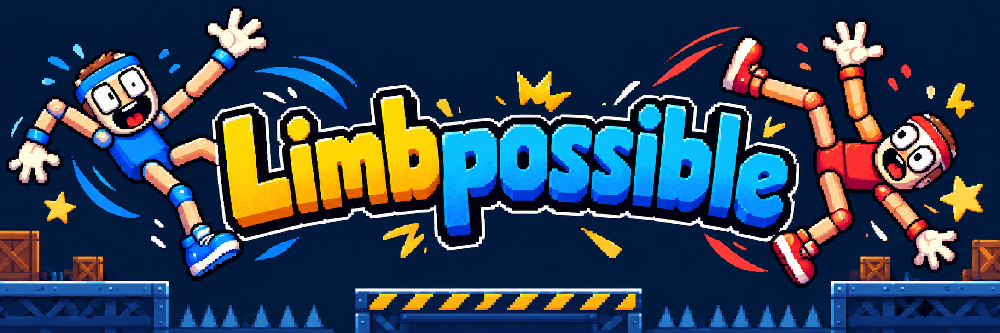

<h1 align="center">LIMBPOSSIBLE</h1>

<p align="center"><strong>Two players. One fighter. Friendly chaos.</strong></p>

Limbpossible is a motion-controlled party brawler where two people share control of one fighter. Tilt your phone to move or turn. Jolt it to jump or punch. Coordinate with your partner, outplay the other team, and try not to fly off the arena.

## How the idea came together

Our first idea was to have four people use their phones to control one fighter, with each player controlling a different limb. As we explored it, we realized the game would be more fun if the controls created a partnership instead of four separate jobs. We grouped the controls into two roles: one player moves the legs, and their partner turns and attacks with the arms. That made coordination the heart of the game—and gave us Limbpossible.

## Phone motion is the controller

A phone is the controller. Tilt it to steer your fighter's legs or turn its arms. Give it a quick, deliberate jolt to jump or throw a punch. The browser reads orientation and accelerometer motion, calibrates a neutral resting position, and translates movement into live game input.

The two roles feel different, so players have to learn their own controls and read what their partner is doing. Motion directly changes the match: a good tilt closes distance, a well-timed punch launches an opponent, and an accidental overcorrection can send your own fighter tumbling. The shared-body controls make physical coordination part of the strategy and the joke.

## How it fits the Mystery Track

Limbpossible brings the track's three requirements together in one shared arena:

- **Phone motion:** tilt controls movement and turning, while accelerometer jolts trigger jumps and punches. Physical movement is central to how each fighter plays.
- **Rivalry:** players compete to knock opposing fighters off the platform. Every pair has to coordinate its movement and attacks to earn the win and the bragging rights.
- **Group play:** matches support an even number of players, starting at four. Each person joins on their own phone, and two players share each fighter, giving everyone an active role in the same match.

The shared fighter connects all three: phone motion gives each teammate control over part of the body, teamwork brings those actions together, and rival fighters give the group a reason to compete.

## How it works technically

The app has three parts: **the phones, a Node.js server, and the host browser displaying the arena.** Players join directly from their phone browsers.

1. **Players join a room.** The host creates a room with a PIN and QR code. Scanning the QR opens the controller page in the phone's browser. The server assigns each player a teammate and an arms or legs role when the host starts.
2. **The phone reads movement.** After permission and calibration, browser sensor APIs measure tilt and acceleration. Our code converts those readings into movement, turning, jumps, and punches.
3. **The phone sends commands through Socket.IO.** This keeps an ongoing connection to the server, typically using WebSockets. The phone sends small input messages representing movement or actions such as a punch.
4. **The server routes commands to the host.** It checks the inputs and identifies which fighter and role they belong to. It also manages the lobby, voting, and connection status.
5. **The host runs the fight.** The host browser updates the game simulation 60 times per second, calculates movement, collisions, and ring-outs, and renders the arena with Three.js.

The path is: **phone sensors → controller commands → server → host simulation → shared arena screen.**

On each phone, browser motion events provide two sensor streams. **Device orientation** measures how the phone is tilted; after calibration, those angles become smoothed movement or turning input. **Device motion** provides acceleration readings; a thresholded, cooldown-limited jolt becomes a jump or punch action. The game asks for motion permission where the browser requires it and checks that both streams are active before a player is ready.

Character and arena votes are coordinated through the room, so all players see the same result. Stale inputs expire quickly, and a disconnected controller can reconnect to its reserved role while the room remains open.

The app is built with Three.js, Node.js, Express, and Socket.IO. Phone motion controls require a supported mobile browser and a secure HTTPS connection; the local laptop host is useful for development and projection, while a trusted HTTPS server or tunnel lets phones connect.

## Run locally

Requires **Node.js 22+**.

```sh
npm ci
npm run dev
```

Open [localhost:3000/lobby](http://localhost:3000/lobby) on the host laptop or projector. Players scan the lobby QR code or enter the game PIN on their phones. Phone motion requires HTTPS and WebSocket support; set the phone-accessible origin in the lobby to update its QR code.

No phones handy? Open **Developer Playground** for a keyboard and bot match, or [preview the phone controller](http://localhost:3000/controller?preview=1).

## Development

- `npm start` — run without automatic restarts.
- `npm test` — run the test suite.
- [Deployment guide](docs/cloudflare-deploy.md) · [Project notes](docs/)

## HackPSU entries

We're entering **General Track: The Mystery Stack, MLH Best Use of Gemini API, and MLH Best Use of ElevenLabs**.

- **Mystery Stack:** four or more players join on their own phones, using tilt and accelerometer jolts to control shared fighters. Each pair must coordinate to defeat rival teams in the same arena.
- **Gemini API:** Gemini turns live match events into fresh announcer commentary, reacting to the fighters, arena, hits, and results as the round unfolds.
- **ElevenLabs:** ElevenLabs gives the announcer a voice, bringing Gemini's reactions to life alongside matching captions on the host screen.
