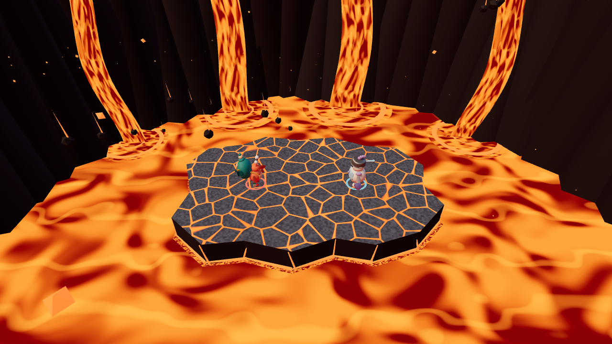

# Volcano Crucible

Implemented on `Glioh/volcano-lava-redesign` in the separate `volcano-lava-redesign` worktree. The original main checkout is unchanged.

The existing `lava` map uses a jagged magma island with glowing crust fissures over a moving molten lake. Nineteen outer chunks glow and shake for two seconds before breaking loose, tilting outward, and sinking into the lava. The first chunk falls at 10 seconds, then another every 1.4 seconds; a smaller central island remains. Missing chunks remove actual fighter support and stay gone until round reset. Basalt crater walls, four animated lava waterfalls, falling volcanic rocks, and rising embers surround the fight.

Seeded vents and volcanic bombs mark their landing areas before impact. Each impact launches nearby fighters once, uses existing hazard feedback, and can be escaped or jumped. The visible outline and support boundary share one polygon. Scenery and hazard visuals use fixed pools; no production dependency was added.

Background falling rocks and their glowing trails have since been removed. Rising embers, marked bomb hazards, and collapsing floor chunks remain. The earlier preview and browser metrics below predate this removal.

## Validation

- `npm test`: 185 passed, 0 failed.
- Lava tests cover jagged edges, safe spawns, height queries, collapse warnings, permanent missing support, sinking, fighter ring-outs through openings, central support, seed reproducibility, hazard warnings/spacing/count limits, single-hit impacts, jump/escape behavior, combat feedback, resets, view pooling, and existing bot pursuit.
- The browser harness rendered all existing map samples, exercised actual host startup, keyboard input, resize, and map switches, and captured lava warnings, eruption, falling bomb, impact, crust warning/fall/breakup, the remaining core, and portrait framing.
- Final browser run: zero JavaScript or shader errors, one host canvas, nine cached environment families. Warmed texture count remained 15 after repeated map switches.
- Sampled intact lava scene: 247 draw calls and 55,150 triangles. Browser frame samples are short and display-paced; they do not establish sustained performance on other hardware.

Raw screenshots and report are in ignored `.visual-validation/after/`. Reproduce using the existing instructions in `visual-upgrade-validation.md`, with `VISUAL_URL` pointing at this worktree's server. The updated harness compares resources after warming all environments, including the new lava family.

Physical lava flow, terrain deformation, and permanent craters are intentionally omitted. Full multiplayer playtesting and final hazard balance remain unverified. Changes are not merged or deployed.
